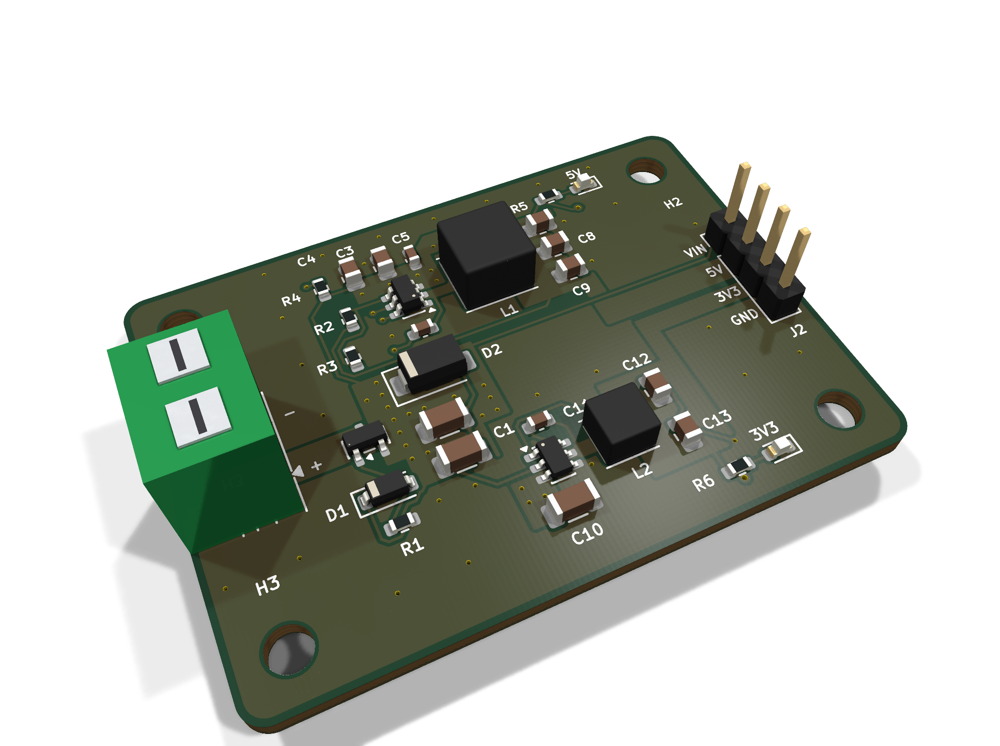
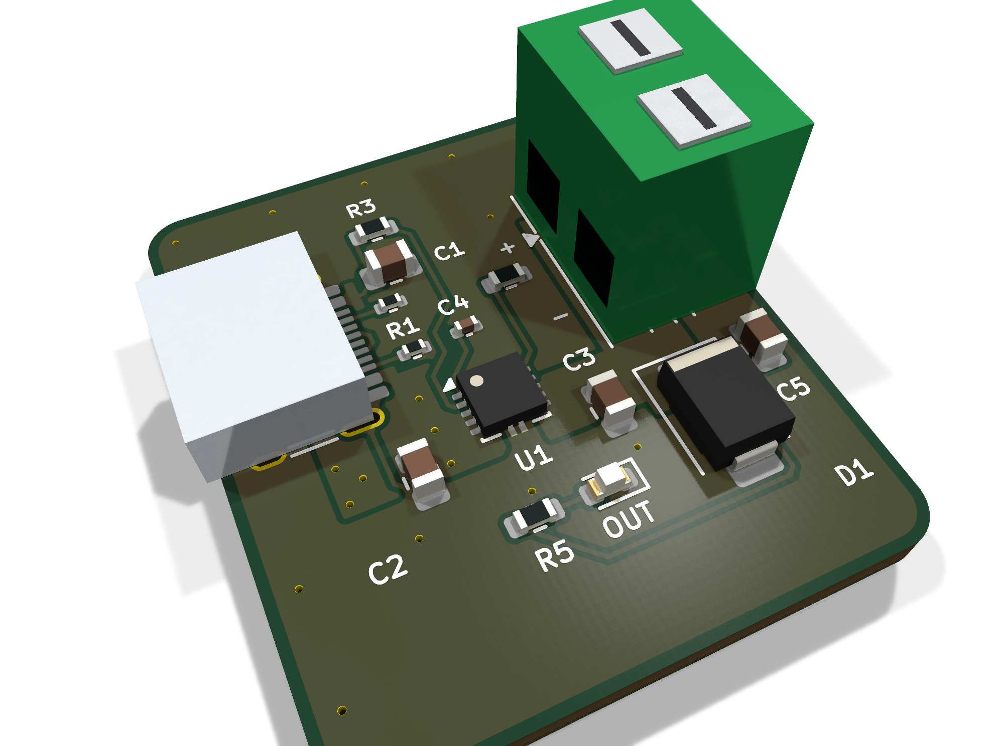

# HeyPCB Power Kit

Six small power and charging boards, each a complete KiCad 10 project with Gerbers, BOM and a CPL fitted to JLCPCB's own footprints.

| Board | What it does | Size | DRC errors / unconnected / parity |
|---|---|---|---|
| [Dual Rail](boards/dual-rail/) | 6-15 V to 5 V / 3 A + 3.3 V / 2 A | 50 x 36 mm, 4 layers | 0 / 0 / 0 |
| [PD Trigger](boards/pd-trigger/) | USB-C PD sink, DIP-selected 5-20 V | 28 x 40 mm, 2 layers | 0 / 0 / 0 |
| [1S Boost](boards/boost-1s/) | One lithium cell to 5.1 V | 28 x 30 mm, 2 layers | 0 / 0 / 0 |
| [Power Mux](boards/power-mux/) | USB-C first, 1S cell as backup | 28 x 32 mm, 2 layers | 0 / 0 / 0 |
| [USB eFuse](boards/usb-efuse/) | 5 V inline protection | 26 x 30 mm, 2 layers | 0 / 0 / 0 |
| [USB-C Power Meter](boards/usb-c-meter/) | Inline power monitor, Qwiic | 32 x 24 mm, 2 layers | 0 / 0 / 0 |

     

**Not fabricated, assembled or powered.** Every number in a board's README is measured by KiCad 10 on the files in its folder (`report.json`). Parts are LCSC-numbered and were in JLCPCB's stock on the date each README gives.

Each board folder holds `kicad/` (project), `fab/` (Gerbers zip, BOM, CPL, STEP, schematic PDF), `media/` (renders and a design-process video) and `board.json` (the brief it was built from).

Designed with the HeyPCB method on KiCad 10 by heypcb-kicad's headless pipeline with Freerouting 2.4.1.

## Licence

CERN-OHL-S-2.0, © 2026 heypcb.ai. See [LICENSE](LICENSE).
