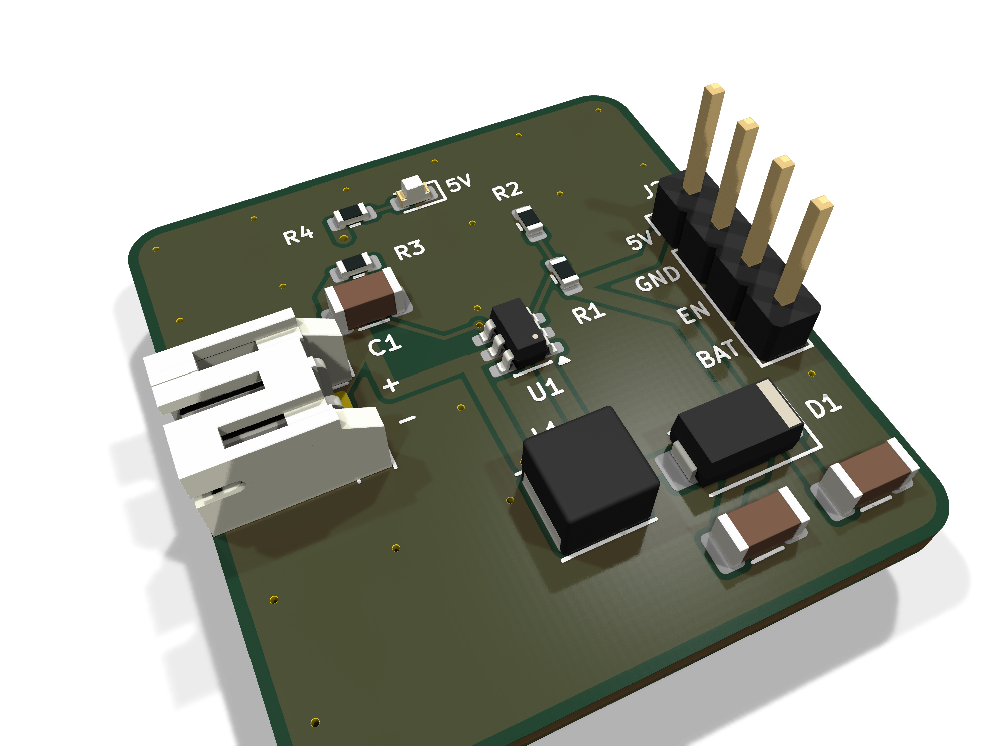
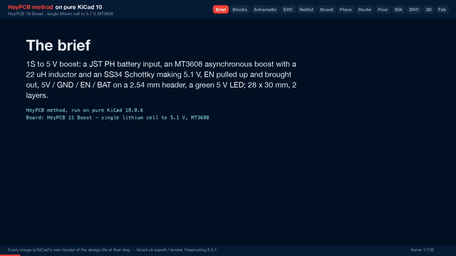

# 1S Boost

One lithium cell in, 5.1 V out: an MT3608 boost with a JST PH input and a 2.54 mm header.

| Layers | Size | Parts | Nets | Connections routed | Vias | ERC errors | DRC errors / unconnected / parity |
|---|---|---|---|---|---|---|---|
| 2 | 28 x 30 mm | 13 | 7 | 24 -> 0 open | 24 | 0 | 0 / 0 / 0 |

**Not fabricated, assembled or powered.** Every number on this page is measured by KiCad 10 on the files in this folder; the full measurements are in [`report.json`](report.json).

| | |
|---|---|
| KiCad project | [`kicad/`](kicad/) |
| Gerbers, BOM, CPL, STEP, schematic PDF | [`fab/`](fab/) |
| Renders | [top](media/top.png), [bottom](media/bottom.png) |
| Design process, every step as KiCad rendered it | [`media/design-process.mp4`](media/design-process.mp4) |

The small board between a single Li-ion or LiPo cell and anything that wants 5 V: an Arduino, a strip of addressable LEDs, a USB gadget. The cell plugs into a JST PH connector on the left; an MT3608 boosts its 3.0-4.2 V to 5.1 V; 5V, GND, EN and the raw cell voltage come out on a 2.54 mm header on the right, labelled on both faces. Designed with the HeyPCB method on KiCad 10, by heypcb-kicad's headless pipeline with Freerouting 2.4.1, from the brief in `board.json`.

## Specs

- **Input:** one Li-ion / LiPo cell (3.0-4.2 V) on a JST S2B-PH-K side-entry connector, + and - marked beside its pads. The MT3608 runs from 2 V.
- **Converter:** MT3608 asynchronous boost (1.2 MHz, 4 A switch-current limit), 22 uH FNR4030S inductor, SS34 3 A Schottky, 22 uF in and 2 x 22 uF out (25 V X5R 1206).
- **Output:** 0.6 V x (1 + 15k / 2k) = 5.10 V. The design target is 1 A from a cell above 3.3 V; that is a datasheet-and-arithmetic figure, not a measurement.
- **EN:** pulled up to the cell through 100k, so the converter runs by default; pull EN to GND on the header to stop it.
- **Header:** 5V, GND, EN, BAT on 2.54 mm pitch, labelled on both faces; a green LED on 5V.
- **Board:** 28 x 30 mm, 2 layers, 1.6 mm; the cell, switch and output paths routed at 0.8 mm.

## Parts

Every line carries an LCSC part number. Stock is JLCPCB's assembly stock on 2026-10-18.

| Designators | Value | LCSC | MPN | JLCPCB tier | Stock |
|---|---|---|---|---|---|
| C1,C2,C3 | 22uF | C12891 | CL31A226KAHNNNE | Basic | 490,670 |
| D1 | SS34 | C8678 | SS34 | Basic | 3,870,562 |
| D2 | Green (5V) | C12624 | KT-0603G | Extended | 500,718 |
| J1 | BATT | C173752 | S2B-PH-K-S(LF)(SN) | Extended | 218,971 |
| J2 | OUT | C2691448 | PZ254V-11-04P | Extended | 887,837 |
| L1 | 22uH | C167883 | FNR4030S220MT | Extended | 48,282 |
| R1 | 15k | C22809 | 0603WAF1502T5E | Basic | 4,101,430 |
| R2 | 2k | C22975 | 0603WAF2001T5E | Basic | 11,345,954 |
| R3 | 100k | C25803 | 0603WAF1003T5E | Basic | 19,335,998 |
| R4 | 2.2k | C4190 | 0603WAF2201T5E | Basic | 6,541,694 |
| U1 | MT3608 | C84817 | MT3608 | Extended | 107,165 |

## Ordering

- PCB: upload `fab/power_boost_1s_gerbers.zip`, 2 layers, 28 x 30 mm, 1.6 mm.
- Assembly: `fab/power_boost_1s_bom.csv` and `fab/power_boost_1s_cpl_jlc.csv`, top side.
- The CPL is fitted to each part's own JLCPCB footprint, pad by pad, and re-checked by laying each footprint where its row says: 13 of 13 rows fitted, worst pin-to-pad offset 0.20 mm.

## Notes

- No battery protection on this board: use a cell with its own protection circuit (most JST-lead LiPos have one), or add a protector.
- EN low stops switching but does not disconnect the output: in an asynchronous boost the cell still reaches 5V through the inductor and the SS34, about 0.3-0.4 V below the cell voltage. Put a switch in the cell lead if the load must go fully off.
- JST PH cell leads do not all use the same polarity. Check the lead against the + and - marks before plugging it in.
- Not built or measured: efficiency, ripple and the 1 A figure are unverified.

## How it was made

Designed with the HeyPCB method on KiCad 10, by heypcb-kicad's headless pipeline with Freerouting 2.4.1, from the brief in [`board.json`](board.json).

## Licence

CERN-OHL-S-2.0, © 2026 heypcb.ai. See the collection's LICENSE.
