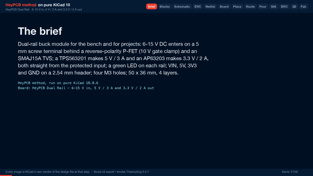

# Dual Rail

A dual-rail buck module: 6-15 V in, 5 V / 3 A and 3.3 V / 2 A out, reverse-polarity protected.

| Layers | Size | Parts | Nets | Connections routed | Vias | ERC errors | DRC errors / unconnected / parity |
|---|---|---|---|---|---|---|---|
| 4 | 50 x 36 mm | 34 | 14 | 57 -> 0 open | 70 | 0 | 0 / 0 / 0 |

**Not fabricated, assembled or powered.** Every number on this page is measured by KiCad 10 on the files in this folder; the full measurements are in [`report.json`](report.json).

| | |
|---|---|
| KiCad project | [`kicad/`](kicad/) |
| Gerbers, BOM, CPL, STEP, schematic PDF | [`fab/`](fab/) |
| Renders | [top](media/top.png), [bottom](media/bottom.png) |
| Design process, every step as KiCad rendered it | [`media/design-process.mp4`](media/design-process.mp4) |

A small power module for the bench and for projects that need both 5 V and 3.3 V from one 6-15 V supply (a 12 V adapter, a 3S pack). A TPS563201 synchronous buck makes 5 V and an AP63203 makes 3.3 V, both straight from the protected input, so neither rail's load heats the other's regulator. The input has a reverse-polarity P-FET and a TVS, every rail has an LED, and VIN, 5V, 3V3 and GND come out on a 2.54 mm header. Designed with the HeyPCB method on KiCad 10 (10.0.6), by heypcb-kicad's headless pipeline with Freerouting 2.4.1, from the brief in `board.json`.

## Specs

- **Input:** 6-15 V DC on a 5 mm MaiXu MX126 screw terminal, marked + and -. The input range stops at 15 V because the TPS563201 is rated to 17 V input (TI SLVSD90B).
- **Reverse polarity:** AO3401A P-FET in the + lead (drain on the terminal, source on the board). A BZT52C10 zener and a 100k resistor hold its gate-source voltage at about -10 V, inside its +-12 V rating, across the whole input range.
- **Transients:** SMAJ15A TVS on the protected input (15 V stand-off, 24.4 V clamp at 16.4 A). It is for transients, not for a sustained over-voltage. 2 x 22 uF / 25 V X5R input bulk.
- **5 V rail:** TPS563201 synchronous buck (TI, 3 A, 580 kHz), 4.7 uH Sunlord SWPA6045S inductor, 3 x 22 uF output. Feedback 82k / 15k: VFB 0.768 V gives 4.96 V.
- **3.3 V rail:** AP63203 fixed 3.3 V synchronous buck (Diodes, 2 A, 1.1 MHz), 4.7 uH Sunlord SWPA4030S inductor, 2 x 22 uF output.
- **Current paths:** the raw input, the protected input, both switch nodes, 5V and 3V3 are copper zones on F.Cu, not tracks. The input zones at each converter are stitched to an In2 VIN plane, and In1 is a solid GND plane.
- **Outputs:** VIN, 5V, 3V3 and GND on a 1x4 2.54 mm header, labelled on both faces; a green LED on each rail.
- **Board:** 50 x 36 mm, 4 layers (F.Cu / In1 GND / In2 VIN + routing / B.Cu), 1.6 mm, four M3 holes at the corners.

## Parts

Every line carries an LCSC part number. Stock is JLCPCB's assembly stock on 2026-10-18.

| Designators | Value | LCSC | MPN | JLCPCB tier | Stock |
|---|---|---|---|---|---|
| C1,C2 | 22uF | C12891 | CL31A226KAHNNNE | Basic | 490,725 |
| C3,C4,C7,C8,C9,C12,C13 | 22uF | C45783 | CL21A226MAQNNNE | Basic | 3,755,166 |
| C5,C6,C11 | 100nF | C14663 | CC0603KRX7R9BB104 | Basic | 31,787,100 |
| C10 | 10uF | C13585 | CL31A106KBHNNNE | Basic | 2,283,157 |
| D1 | BZT52C10 | C173431 | BZT52C10 | Extended | 277,380 |
| D2 | SMAJ15A | C908769 | SMAJ15A | Extended | 112,547 |
| D3 | Green (5V) | C12624 | KT-0603G | Extended | 500,718 |
| D4 | Green (3V3) | C12624 | KT-0603G | Extended | 500,718 |
| J1 | VIN 6-15V | C5188434 | MX126-5.0-02P-GN01-Cu-S-A | Extended | 35,962 |
| J2 | OUT | C2691448 | PZ254V-11-04P | Extended | 887,860 |
| L1 | 4.7uH | C78804 | SWPA6045S4R7MT | Extended | 30,574 |
| L2 | 4.7uH | C57269 | SWPA4030S4R7MT | Extended | 19,258 |
| Q1 | AO3401A | C15127 | AO3401A | Basic | 696,636 |
| R1,R4 | 100k | C25803 | 0603WAF1003T5E | Basic | 19,342,480 |
| R2 | 82k | C23254 | 0603WAF8202T5E | Basic | 1,210,269 |
| R3 | 15k | C22809 | 0603WAF1502T5E | Basic | 4,101,125 |
| R5 | 2.2k | C4190 | 0603WAF2201T5E | Basic | 6,541,747 |
| R6 | 1k | C21190 | 0603WAF1001T5E | Basic | 23,229,534 |
| U1 | TPS563201 | C116592 | TPS563201DDCR | Extended | 114,139 |
| U2 | AP63203WU-7 | C780769 | AP63203WU-7 | Extended | 3,515 |

## Ordering

- PCB: upload `fab/power_dual_buck_gerbers.zip`, 4 layers, 50 x 36 mm, 1.6 mm.
- Assembly: `fab/power_dual_buck_bom.csv` and `fab/power_dual_buck_cpl_jlc.csv`, top side.
- The CPL is fitted to each part's own JLCPCB footprint, pad by pad, and re-checked by laying each footprint where its row says: 28 of 30 rows fitted, worst pin-to-pad offset 0.28 mm.
- Not fitted (no JLCPCB footprint to fit to), rotation from KiCad's: L1, L2. Check these in JLCPCB's placement preview.

## Notes

- The output ratings (3 A, 2 A) are the converters' datasheet ratings. Nothing here measures temperature or ripple at load: the board has not been built.
- The AP63203WU-7 (C780769) has one LCSC listing; 3,515 in stock when this was packaged. The same part is on PD Brick, Spinner and Ice Core.
- L1 and L2 (Sunlord SWPA inductors) are not in EasyEDA's footprint library, so their CPL rotation is KiCad's and was not fitted. Both are symmetric two-pad parts with their pads along x in KiCad. Check them in JLCPCB's placement preview.

## How it was made

Designed with the HeyPCB method on KiCad 10, by heypcb-kicad's headless pipeline with Freerouting 2.4.1, from the brief in [`board.json`](board.json).

## Licence

CERN-OHL-S-2.0, © 2026 heypcb.ai. See the collection's LICENSE.
