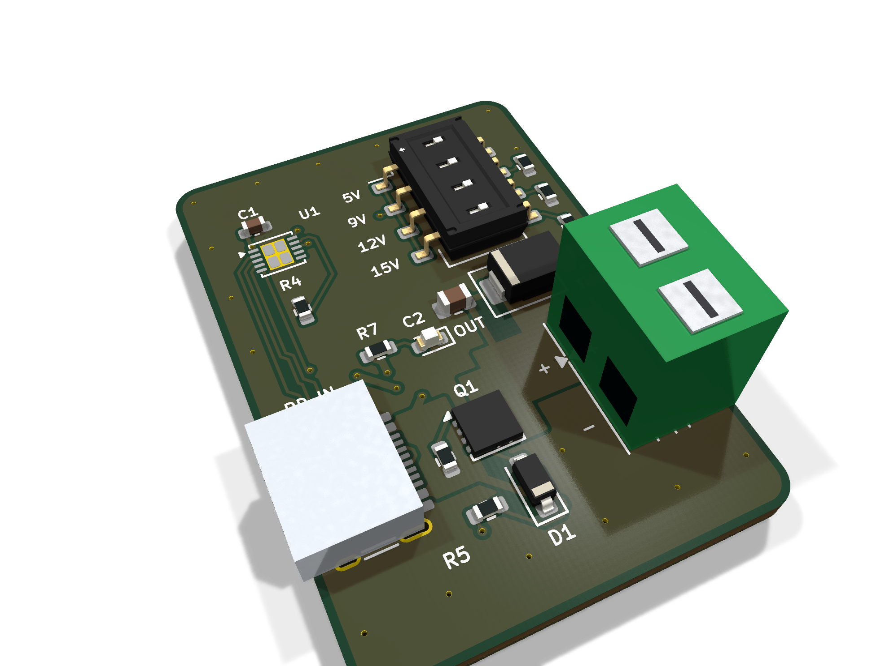
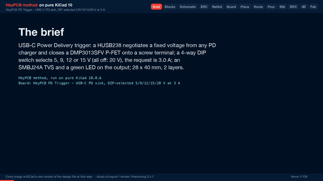

# PD Trigger

A USB-C Power Delivery trigger: any PD charger in, a fixed 5, 9, 12, 15 or 20 V at 3 A out on a screw terminal, picked with a DIP switch.

| Layers | Size | Parts | Nets | Connections routed | Vias | ERC errors | DRC errors / unconnected / parity |
|---|---|---|---|---|---|---|---|
| 2 | 28 x 40 mm | 17 | 15 | 47 -> 0 open | 35 | 0 | 0 / 0 / 0 |

**Not fabricated, assembled or powered.** Every number on this page is measured by KiCad 10 on the files in this folder; the full measurements are in [`report.json`](report.json).

| | |
|---|---|
| KiCad project | [`kicad/`](kicad/) |
| Gerbers, BOM, CPL, STEP, schematic PDF | [`fab/`](fab/) |
| Renders | [top](media/top.png), [bottom](media/bottom.png) |
| Design process, every step as KiCad rendered it | [`media/design-process.mp4`](media/design-process.mp4) |

Plug a USB-C PD charger in and get one fixed voltage out, for powering a bench project, a strip of LEDs or a 12 V tool from a laptop charger. A Hynetek HUSB238 negotiates the contract and only then turns on a P-FET onto the output terminal, so nothing downstream sees a voltage it did not ask for. A 4-way DIP switch picks 5, 9, 12 or 15 V; all switches off asks for 20 V. Designed with the HeyPCB method on KiCad 10, by heypcb-kicad's headless pipeline with Freerouting 2.4.1, from the brief in `board.json`.

## Specs

- **Input:** USB-C receptacle (CC1 and CC2 to the HUSB238; D+ and D- wired for chargers that look at them).
- **Voltage select:** a 4-way DIP switch puts one resistor on VSET (HUSB238 table 6): 0 = 5 V, 6.04k = 9 V, 10k = 12 V, 14k = 15 V, nothing = 20 V. Turn on one switch at most; the positions are labelled on both faces.
- **Current request:** ISET 22.6k = 3.0 A. Not 3.25 A (ISET open), because a standard 3 A charger cannot meet 3.25 A and the HUSB238 would fall back to a lower voltage.
- **Output switch:** DMP3013SFV P-FET (-30 V, 9.5 mOhm at VGS -10 V, about 0.09 W at 3 A) driven by the HUSB238's open-drain GATE through 10k, with a 10 V zener holding VGS inside its rating at 20 V.
- **Output:** 5 mm MaiXu MX126 2-pin screw terminal, SMBJ24A TVS across it, green LED when the output is on.
- **Current paths:** VBUS and the switched output are copper zones, not tracks.
- **Board:** 28 x 40 mm, 2 layers, 1.6 mm.

## Parts

Every line carries an LCSC part number. Stock is JLCPCB's assembly stock on 2026-10-18.

| Designators | Value | LCSC | MPN | JLCPCB tier | Stock |
|---|---|---|---|---|---|
| C1 | 1uF | C15849 | CL10A105KB8NNNC | Basic | 9,261,663 |
| C2 | 1uF | C28323 | CL21B105KBFNNNE | Basic | 2,337,702 |
| D1 | BZT52C10 | C173431 | BZT52C10 | Extended | 277,380 |
| D2 | SMBJ24A | C123819 | SMBJ24A | Extended | 59,843 |
| D3 | Green (OUT) | C12624 | KT-0603G | Extended | 500,718 |
| J1 | USB-C PD IN | C165948 | TYPE-C-31-M-12 | Extended | 362,231 |
| J2 | OUT | C5188434 | MX126-5.0-02P-GN01-Cu-S-A | Extended | 35,962 |
| Q1 | DMP3013SFV | C264098 | DMP3013SFV-7 | Extended | 3,984 |
| R1 | 6.04k | C25977 | 0603WAF6041T5E | Extended | 135,034 |
| R2,R5,R7 | 10k | C25804 | 0603WAF1002T5E | Basic | 39,990,901 |
| R3 | 14k | C22803 | 0603WAF1402T5E | Extended | 11,051 |
| R4 | 22.6k | C2999509 | FRC0603F2262TS | Extended | 92,673 |
| R6 | 100k | C25803 | 0603WAF1003T5E | Basic | 19,336,314 |
| SW1 | VSET 5/9/12/15 | C6331176 | 2.54-4P TPGT | Extended | 45,129 |
| U1 | HUSB238_002DD | C7471904 | HUSB238_002DD | Extended | 13,737 |

## Ordering

- PCB: upload `fab/power_pd_trigger_gerbers.zip`, 2 layers, 28 x 40 mm, 1.6 mm.
- Assembly: `fab/power_pd_trigger_bom.csv` and `fab/power_pd_trigger_cpl_jlc.csv`, top side.
- The CPL is fitted to each part's own JLCPCB footprint, pad by pad, and re-checked by laying each footprint where its row says: 17 of 17 rows fitted, worst pin-to-pad offset 0.21 mm.

## Notes

- The 3 A rating is the request the board makes; whether a charger gives 3 A at the chosen voltage is the charger's PDO list. Nothing here is measured at load: the board has not been built.
- The DMP3013SFV (C264098) had 3,984 in JLCPCB's stock when this was packaged, the lowest of the parts list. Check it before ordering.
- SDA and SCL are not connected; the HUSB238's I2C mode is not used.
- The USB-C receptacle (HRO TYPE-C-31-M-12) renders as a plain box: KiCad's library footprint names a 3D model that KiCad does not ship. The footprint and its pads are KiCad's own and are fitted to JLCPCB's land.

## How it was made

Designed with the HeyPCB method on KiCad 10, by heypcb-kicad's headless pipeline with Freerouting 2.4.1, from the brief in [`board.json`](board.json).

## Licence

CERN-OHL-S-2.0, © 2026 heypcb.ai. See the collection's LICENSE.
