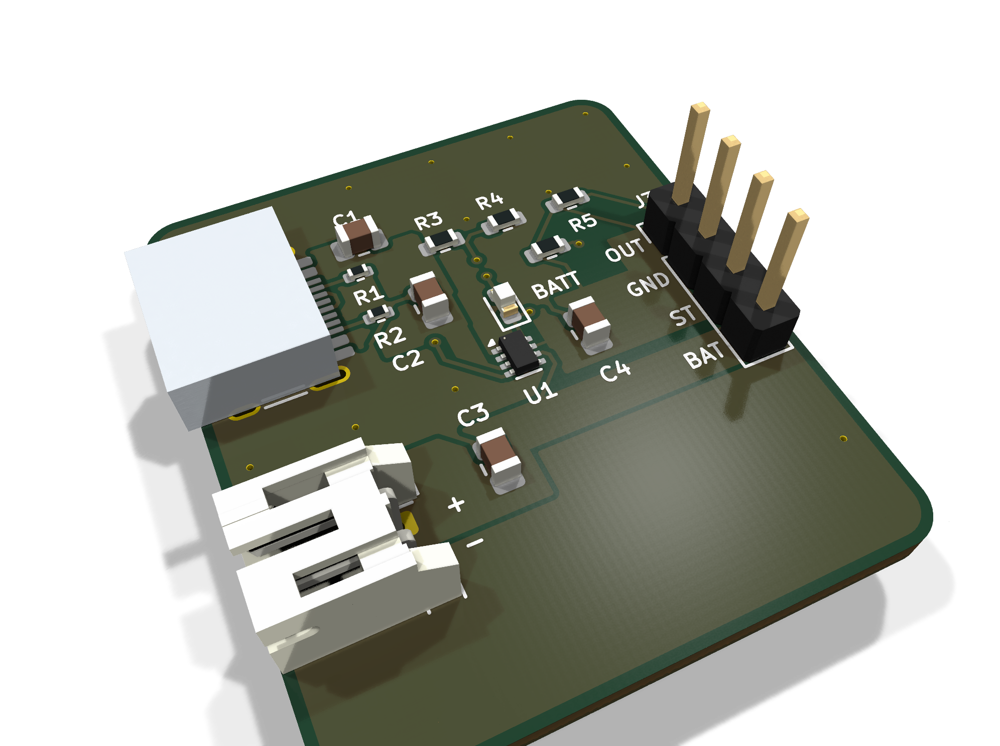
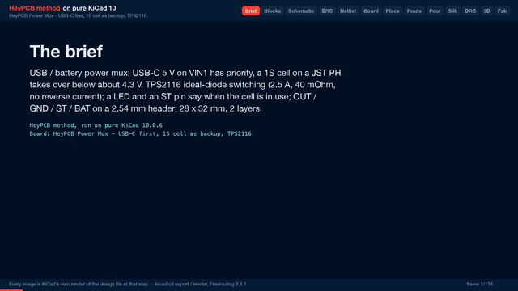

# Power Mux

USB-C first, a lithium cell as backup: a TPS2116 ideal-diode power mux with no diode drop and a pin that says which source is live.

| Layers | Size | Parts | Nets | Connections routed | Vias | ERC errors | DRC errors / unconnected / parity |
|---|---|---|---|---|---|---|---|
| 2 | 28 x 32 mm | 15 | 11 | 39 -> 0 open | 21 | 0 | 0 / 0 / 0 |

**Not fabricated, assembled or powered.** Every number on this page is measured by KiCad 10 on the files in this folder; the full measurements are in [`report.json`](report.json).

| | |
|---|---|
| KiCad project | [`kicad/`](kicad/) |
| Gerbers, BOM, CPL, STEP, schematic PDF | [`fab/`](fab/) |
| Renders | [top](media/top.png), [bottom](media/bottom.png) |
| Design process, every step as KiCad rendered it | [`media/design-process.mp4`](media/design-process.mp4) |

For a project that should keep running when the USB cable comes out: plug USB-C in and the load runs from USB; unplug it and a 1S cell on the JST PH connector takes over, with no Schottky drop and no current pushed back into either source. A TPS2116 in priority mode does the switching; the ST pin and a green LED tell the project when it is on the cell. OUT, GND, ST and the raw cell voltage are on a 2.54 mm header. Designed with the HeyPCB method on KiCad 10, by heypcb-kicad's headless pipeline with Freerouting 2.4.1, from the brief in `board.json`.

## Specs

- **Inputs:** USB-C 5 V (VIN1, 5.1k on CC1 and CC2, so any USB-C charger gives 5 V) and one Li-ion / LiPo cell on a JST S2B-PH-K connector (VIN2), + and - marked.
- **Switchover:** priority mode (MODE tied to VIN1). A 33k / 10k divider on PR1 hands over to the cell when USB falls below 1 V x 43 / 10 = 4.3 V, 3.96-4.64 V over the TPS2116's VREF tolerance (0.92-1.08 V, datasheet SLVSFG1A).
- **Switch:** TPS2116, 40 mOhm per channel, 2.5 A continuous, reverse-current blocking; break-before-make on switchover, so a large output capacitor or a hold-up cap on the load rides through the gap.
- **Status:** ST is open drain, pulled up to OUT through 100k: high on USB, low on the cell (and in thermal shutdown). The green BATT LED lights while on the cell.
- **Current paths:** VUSB, VBAT and OUT are copper zones from connector to cap to header; the mux's 0.5 mm-pitch leads are entered by short necks.
- **Board:** 28 x 32 mm, 2 layers, 1.6 mm.

## Parts

Every line carries an LCSC part number. Stock is JLCPCB's assembly stock on 2026-10-18.

| Designators | Value | LCSC | MPN | JLCPCB tier | Stock |
|---|---|---|---|---|---|
| C1,C4 | 10uF | C15850 | CL21A106KAYNNNE | Basic | 6,488,558 |
| C2,C3 | 1uF | C28323 | CL21B105KBFNNNE | Basic | 2,336,668 |
| D1 | Green (BATT) | C12624 | KT-0603G | Extended | 500,697 |
| J1 | USB-C | C165948 | TYPE-C-31-M-12 | Extended | 362,217 |
| J2 | BATT | C173752 | S2B-PH-K-S(LF)(SN) | Extended | 218,971 |
| J3 | OUT | C2691448 | PZ254V-11-04P | Extended | 887,837 |
| R1,R2 | 5.1k | C25905 | 0402WGF5101TCE | Basic | 5,089,075 |
| R3 | 33k | C4216 | 0603WAF3302T5E | Basic | 3,599,548 |
| R4 | 10k | C25804 | 0603WAF1002T5E | Basic | 39,984,479 |
| R5 | 100k | C25803 | 0603WAF1003T5E | Basic | 19,335,638 |
| R6 | 1k | C21190 | 0603WAF1001T5E | Basic | 23,225,827 |
| U1 | TPS2116 | C3235557 | TPS2116DRLR | Extended | 61,962 |

## Ordering

- PCB: upload `fab/power_mux_usb_bat_gerbers.zip`, 2 layers, 28 x 32 mm, 1.6 mm.
- Assembly: `fab/power_mux_usb_bat_bom.csv` and `fab/power_mux_usb_bat_cpl_jlc.csv`, top side.
- The CPL is fitted to each part's own JLCPCB footprint, pad by pad, and re-checked by laying each footprint where its row says: 15 of 15 rows fitted, worst pin-to-pad offset 0.10 mm.

## Notes

- Both inputs must stay within 1.6-5.5 V (6 V absolute maximum): USB 5 V and a single lithium cell. A 2S pack, a 9 V adapter or a USB PD source set above 5 V would destroy the TPS2116; this board's CC resistors ask a charger for 5 V only.
- No charger on this board: the cell is only discharged. Pair it with a charger, or use the cell's own charger.
- Not built or measured: the switchover threshold, the output dip during switchover and the 2.5 A rating are from the datasheet.
- The USB-C receptacle (HRO TYPE-C-31-M-12) renders as a plain box: KiCad's library footprint names a 3D model that KiCad does not ship. The footprint and its pads are KiCad's own and are fitted to JLCPCB's land.

## How it was made

Designed with the HeyPCB method on KiCad 10, by heypcb-kicad's headless pipeline with Freerouting 2.4.1, from the brief in [`board.json`](board.json).

## Licence

CERN-OHL-S-2.0, © 2026 heypcb.ai. See the collection's LICENSE.
