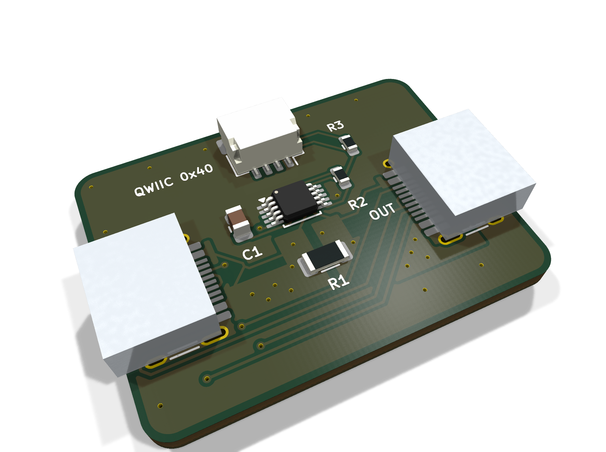
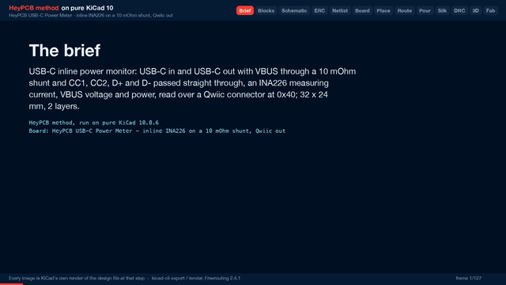

# USB-C Power Meter

Put it in a USB-C cable run and read volts, amps and watts over Qwiic: an INA226 on a 10 mOhm shunt in VBUS, with CC and USB 2.0 passed straight through.

| Layers | Size | Parts | Nets | Connections routed | Vias | ERC errors | DRC errors / unconnected / parity |
|---|---|---|---|---|---|---|---|
| 2 | 32 x 24 mm | 8 | 10 | 41 -> 0 open | 35 | 0 | 0 / 0 / 0 |

**Not fabricated, assembled or powered.** Every number on this page is measured by KiCad 10 on the files in this folder; the full measurements are in [`report.json`](report.json).

| | |
|---|---|
| KiCad project | [`kicad/`](kicad/) |
| Gerbers, BOM, CPL, STEP, schematic PDF | [`fab/`](fab/) |
| Renders | [top](media/top.png), [bottom](media/bottom.png) |
| Design process, every step as KiCad rendered it | [`media/design-process.mp4`](media/design-process.mp4) |

A small inline meter for logging what a USB-C device actually draws: plug the charger into IN and the device into OUT, connect the Qwiic port to a microcontroller, and read the bus voltage, current and power from an INA226 at I2C address 0x40. CC1 and CC2 run straight through, so a USB PD charger and sink still negotiate with each other, and D+ / D- pass through for USB 2.0. Designed with the HeyPCB method on KiCad 10, by heypcb-kicad's headless pipeline with Freerouting 2.4.1, from the brief in `board.json`.

## Specs

- **Pass-through:** two HRO TYPE-C-31-M-12 receptacles (USB 2.0, 16 pins); VBUS through the shunt, CC1, CC2, D+ and D- wired straight across. No resistors on CC: the board is not a source or a sink, the devices on either side are.
- **Measurement:** INA226 (TI), high side, shunt 10 mOhm 1 % 1 W (FMF06FTHR010-LH). Full scale 81.92 mV / 10 mOhm = 8.19 A, one LSB 0.25 mA; bus voltage 0-36 V at 1.25 mV per LSB, taken on the load side so the power is what the device receives. Covers 5-20 V USB PD.
- **Interface:** Qwiic / STEMMA QT (JST SH 4-pin): GND, 3.3 V, SDA, SCL. The INA226 runs from the Qwiic 3.3 V; 4.7k pull-ups on SDA and SCL. Address 0x40 (A0 = A1 = GND). Alert is not connected.
- **Current paths:** VBUS on each side of the shunt is a zone on both layers, stitched; tracks are kept off B.Cu between the receptacles so the bottom-layer VBUS planes stay whole.
- **Board:** 32 x 24 mm, 2 layers, 1.6 mm.

## Parts

Every line carries an LCSC part number. Stock is JLCPCB's assembly stock on 2026-10-18.

| Designators | Value | LCSC | MPN | JLCPCB tier | Stock |
|---|---|---|---|---|---|
| C1 | 100nF | C28233 | CL21B104KCFNNNE | Basic | 1,356,236 |
| J1 | USB-C IN | C165948 | TYPE-C-31-M-12 | Extended | 362,213 |
| J2 | USB-C OUT | C165948 | TYPE-C-31-M-12 | Extended | 362,213 |
| J3 | QWIIC | C160404 | SM04B-SRSS-TB(LF)(SN) | Extended | 60,043 |
| R1 | 10m | C105362 | FMF06FTHR010-LH | Extended | 145,294 |
| R2,R3 | 4.7k | C23162 | 0603WAF4701T5E | Basic | 18,626,473 |
| U1 | INA226 | C49851 | INA226AIDGSR | Extended | 39,617 |

## Ordering

- PCB: upload `fab/power_usb_meter_gerbers.zip`, 2 layers, 32 x 24 mm, 1.6 mm.
- Assembly: `fab/power_usb_meter_bom.csv` and `fab/power_usb_meter_cpl_jlc.csv`, top side.
- The CPL is fitted to each part's own JLCPCB footprint, pad by pad, and re-checked by laying each footprint where its row says: 8 of 8 rows fitted, worst pin-to-pad offset 0.07 mm.

## Notes

- Made for 3 A. On the IN receptacle the zone joins the lower VBUS pad (contacts A9 / B4) to the shunt directly; the upper pad (A4 / B9) reaches it through a 0.2 mm track about 3 mm long, because the CC and USB 2.0 tracks leave the receptacle between the two pads. The OUT side's zone joins both pads.
- The silkscreen marks OUT beside the right receptacle; the IN word found no free spot beside the left one, which is the side with the Qwiic label above it. The supply goes in on the left.
- USB 2.0 data crosses the board on plain 0.2 mm tracks, not an impedance-controlled pair: full speed will be fine; high speed is not verified.
- The board draws nothing from VBUS: without a Qwiic host it is a passive pass-through.
- The USB-C receptacles render as plain boxes: KiCad's library footprint names a 3D model that KiCad does not ship. The footprint and its pads are KiCad's own and are fitted to JLCPCB's land.
- Not built or measured: accuracy, the 3 A rating and USB 2.0 signal quality are unverified.

## How it was made

Designed with the HeyPCB method on KiCad 10, by heypcb-kicad's headless pipeline with Freerouting 2.4.1, from the brief in [`board.json`](board.json).

## Licence

CERN-OHL-S-2.0, © 2026 heypcb.ai. See the collection's LICENSE.
