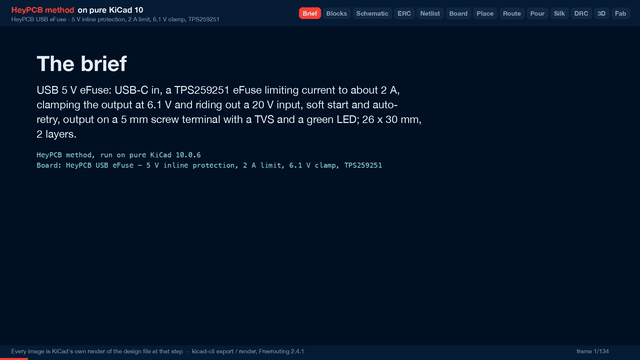

# USB eFuse

A 5 V eFuse between a USB-C supply and your project: about 2 A current limit, output clamped at 6.1 V, rides out a 20 V input, soft start and auto-retry.

| Layers | Size | Parts | Nets | Connections routed | Vias | ERC errors | DRC errors / unconnected / parity |
|---|---|---|---|---|---|---|---|
| 2 | 26 x 30 mm | 15 | 11 | 39 -> 0 open | 22 | 0 | 0 / 0 / 0 |

**Not fabricated, assembled or powered.** Every number on this page is measured by KiCad 10 on the files in this folder; the full measurements are in [`report.json`](report.json).

| | |
|---|---|
| KiCad project | [`kicad/`](kicad/) |
| Gerbers, BOM, CPL, STEP, schematic PDF | [`fab/`](fab/) |
| Renders | [top](media/top.png), [bottom](media/bottom.png) |
| Design process, every step as KiCad rendered it | [`media/design-process.mp4`](media/design-process.mp4) |

The protection a bench project, a LED strip or a motor driver should have between it and a USB charger: a short or an overload is limited to about 2 A and retried instead of pulling the supply down, a charger or cable that puts more than 5 V on VBUS is clamped to 6.1 V at the output, and the load's capacitors charge through a soft start. USB-C in on the left, a 5 mm screw terminal out on the right, a green LED when the output is on. Designed with the HeyPCB method on KiCad 10, by heypcb-kicad's headless pipeline with Freerouting 2.4.1, from the brief in `board.json`.

## Specs

- **Input:** USB-C, 5.1k on CC1 and CC2 (a USB-C charger gives 5 V). The TPS259251 is rated to 20 V on its input (22 V for under 1 ms) and runs from 4.5-5.5 V.
- **Current limit:** RILIM 45.3k: 2.05 A typical, 1.72-2.42 A (TPS25925x datasheet, at VIN-OUT 5 V). Auto-retry after an overload or thermal shutdown.
- **Over-voltage:** the output is clamped at 6.1 V (TPS259251); undervoltage lockout at 4.3 V (default, 1 M from VIN to EN/UVLO).
- **Soft start:** 10 nF on dV/dT; output cap 10 uF.
- **Output:** 5 mm MaiXu MX126 screw terminal, + and - marked, SMBJ24A TVS and 1 uF across it, green LED.
- **Current paths:** VUSB is a zone on both layers, stitched, from the receptacle's four VBUS pins to the eFuse's VIN pins; VOUT is a zone from its OUT pins to the terminal and the TVS.
- **Board:** 26 x 30 mm, 2 layers, 1.6 mm.

## Parts

Every line carries an LCSC part number. Stock is JLCPCB's assembly stock on 2026-10-18.

| Designators | Value | LCSC | MPN | JLCPCB tier | Stock |
|---|---|---|---|---|---|
| C1,C3 | 10uF | C15850 | CL21A106KAYNNNE | Basic | 6,484,766 |
| C2,C5 | 1uF | C28323 | CL21B105KBFNNNE | Basic | 2,336,678 |
| C4 | 10nF | C15195 | CL05B103KB5NNNC | Basic | 6,125,751 |
| D1 | SMBJ24A | C123819 | SMBJ24A | Extended | 59,843 |
| D2 | Green (OUT) | C12624 | KT-0603G | Extended | 500,697 |
| J1 | USB-C | C165948 | TYPE-C-31-M-12 | Extended | 362,219 |
| J2 | OUT | C5188434 | MX126-5.0-02P-GN01-Cu-S-A | Extended | 35,962 |
| R1,R2 | 5.1k | C25905 | 0402WGF5101TCE | Basic | 5,088,156 |
| R3 | 1M | C22935 | 0603WAF1004T5E | Basic | 5,598,120 |
| R4 | 45.3k | C23058 | 0603WAF4532T5E | Extended | 64,416 |
| R5 | 2.2k | C4190 | 0603WAF2201T5E | Basic | 6,541,337 |
| U1 | TPS259251 | C527680 | TPS259251DRCR | Extended | 2,748 |

## Ordering

- PCB: upload `fab/power_efuse_usb_gerbers.zip`, 2 layers, 26 x 30 mm, 1.6 mm.
- Assembly: `fab/power_efuse_usb_bom.csv` and `fab/power_efuse_usb_cpl_jlc.csv`, top side.
- The CPL is fitted to each part's own JLCPCB footprint, pad by pad, and re-checked by laying each footprint where its row says: 15 of 15 rows fitted, worst pin-to-pad offset 0.21 mm.

## Notes

- The TPS259251DRCR (C527680) had 2,748 in JLCPCB's stock when this was packaged, the lowest on the parts list. Check it before ordering.
- A 20 V input is survived, not passed: the output clamps at 6.1 V and the eFuse drops the rest across itself, so with a load it heats and may cycle through thermal shutdown and auto-retry. It is a fault condition, not an operating mode.
- The USB-C receptacle (HRO TYPE-C-31-M-12) renders as a plain box: KiCad's library footprint names a 3D model that KiCad does not ship. The footprint and its pads are KiCad's own and are fitted to JLCPCB's land.
- Not built or measured: the current limit and the clamp are datasheet figures.

## How it was made

Designed with the HeyPCB method on KiCad 10, by heypcb-kicad's headless pipeline with Freerouting 2.4.1, from the brief in [`board.json`](board.json).

## Licence

CERN-OHL-S-2.0, © 2026 heypcb.ai. See the collection's LICENSE.
